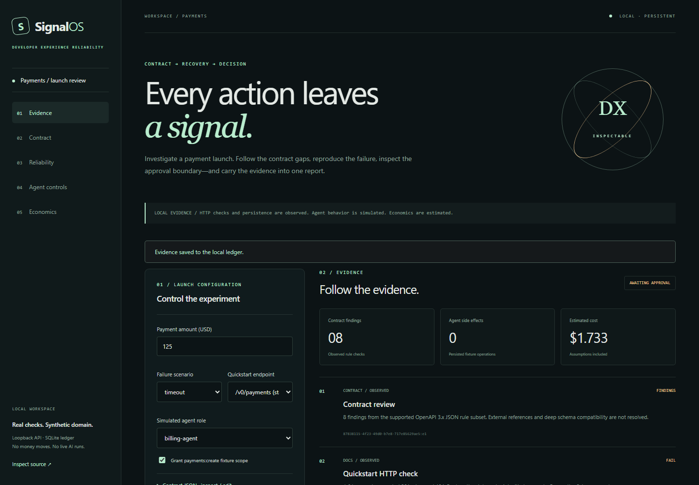

# SignalOS — Developer Experience Reliability

[](https://github.com/Amyvdev1/signalos-developer-experience-platform/actions/workflows/verify.yml)

**SignalOS makes developer experience inspectable—from API contract to failure recovery, agent approval, and an exportable decision trail.**

Built and maintained by Amy Villa. A portfolio-scale, locally runnable platform with real HTTP checks, deterministic payment fixtures, SQLite persistence, and explicit evidence boundaries.



## Start in three commands

Requires Node.js **24 LTS** and npm. No API keys or paid accounts.

```sh
npm ci
npm run build
npm start
```

Open **http://127.0.0.1:4320**. The API and console share one local server. SQLite lives in `data/signalos.sqlite`; do not commit that directory. Optional `PORT` and `DATABASE_PATH` environment variables are read directly; `.env` is an example, not automatically loaded. Windows PowerShell: `$env:PORT='4321'; npm start`.

## The payment-launch investigation

1. Run **Launch investigation** with the defaults.
2. Inspect the OpenAPI contract: missing 429 schema, retry guidance, authentication declaration, and idempotency requirement.
3. Observe the quickstart's stale `/v0/payments` path return **404** through the real local HTTP fixture.
4. Follow the timeout: the fixture commits an operation, delays its response, and the TypeScript client's deadline expires.
5. The retry uses the **same idempotency key** and returns the existing operation. Two attempts create exactly one reliability-fixture payment.
6. Inspect HMAC verification, a rejected stale delivery, and a synthetic out-of-order event stream.
7. The simulated agent asks for `create_payment`. Its role, scope and amount pass policy checks, but a financial side effect **requires confirmation**.
8. Before approval, the agent has **zero side effects**. Approve or reject explicitly; approval binds the original amount and policy, expires after five minutes, and stale repeated submissions fail.
9. Replay under the original policy or compare a stricter $50 policy. Each replay has its own ID and evidence; the original remains intact.
10. Inspect cost assumptions and export **Markdown, JSON, HTML or CSV**.

The reliability experiment and agent action use separate idempotency namespaces. A reliability fixture is not an agent side effect.

## What is implemented

| Module | Implemented slice |
|---|---|
| Contract Observatory | OpenAPI 3.x JSON rule subset; unique operation IDs; auth declaration; 429 schema; retry and idempotency guidance; error coverage; operation/response removal, renamed SDK methods, and newly required parameters |
| Reliability Lab | Real loopback HTTP failures (401/404/429/500/timeout); committed-timeout recovery; persistent idempotency; conflicting key rejection; HMAC-SHA256; replay-window tests; synthetic event ordering |
| Agent Control Plane | Strict payment argument schema; role/scope/amount policy; expiring argument-and-policy-bound approval; denial/rejection; original-versus-stricter replay |
| Evidence Ledger | SQLite migration; revision conflict protection; original run/input/policy snapshots; ordered evidence with provenance labels and finding links |
| SDK / Docs supporting slice | Hand-written typed payment client; loopback transport; executable stale/current endpoint example. Not a general SDK generator or Markdown shell executor |
| Economics supporting slice | Estimated tool attempts, review labor, expected failure loss, manual baseline and conditional partial/no-automation recommendation; unknown cost remains null |
| Console / Reports | Responsive React UI, configuration, error/loading/empty states, historical runs, evidence views, JSON/Markdown/HTML/CSV export |

## Verification

```sh
npm run typecheck
npm test
npm run build
npx playwright install chromium
npm run test:e2e
npm run report
```

Tests cover formulas, policy adversarial inputs, expired/mismatched approval, signatures, replay windows, duplicate permutations, conflict handling, actual HTTP failures, approval/rejection, immutable replay, migration/persistence, intake validation and report exports. Playwright covers desktop/mobile investigation → approval → reload → policy replay → export. `npm run report` keeps the agent awaiting approval; automation never pretends a human approved.

GitHub Actions runs locked installation, strict type checks, tests, production build, dependency audit, browser checks and report artifacts. A separate weekly workflow repeats synthetic verification; it writes artifacts, not bot commits.

## Scope and next steps

This is the **finished MVP vertical slice**, not all eight modules of the long-term specification. No live AI, real financial provider, production identities, customer analytics, cloud deployment, npm publication or enterprise security certification. Roles are fixture inputs. HMAC uses a visibly synthetic local key. Report text labels observed, estimated, assumed and synthetic evidence separately.

Next: full SDK generation and schema drift, restricted executable Markdown tutorials, synthetic onboarding comparisons, an evidence/feedback graph, sensitivity analysis, PR-report integration and release packaging. See [roadmap](docs/ROADMAP.md).

- [Architecture](docs/architecture.md)
- [Code tour](docs/CODE_TOUR.md)
- [Product decisions](docs/PRODUCT_DECISIONS.md)
- [Threat model](docs/THREAT_MODEL.md)
- [Evidence boundaries](docs/EVIDENCE_BOUNDARIES.md)
- [Walkthrough](docs/walkthrough.md)
- [Engineering article](docs/engineering-note.md)
- [MIT license](LICENSE)
