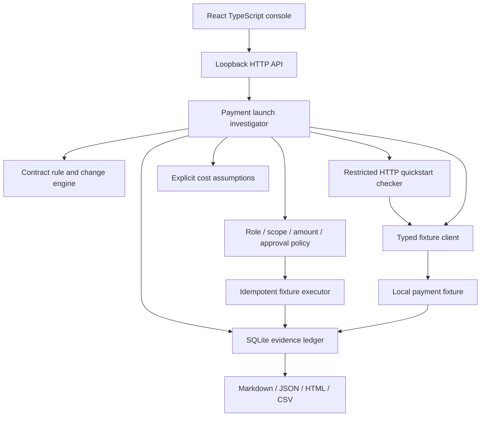

# Architecture

`apps/api` coordinates modules; engines in `packages/` do not import the console. Shared types carry findings, immutable input/policy snapshots, revision, approval binding, estimates and evidence. Node 24 executes erasable TypeScript; `tsc --noEmit` is a separate strict correctness gate. Vite builds only the browser surface.

## Persistence

Migration 1 creates runs, ordered evidence, payment idempotency keys and scenario attempt counters. Foreign keys and JSON checks are enforced. Writes to a run and its evidence are transactional; updates compare the expected revision. Parameters are bound in SQL. A replay creates a new run and new fixture keys; it never edits the original.

The payment write and run approval update are separate transactions. The idempotency key makes a retry recover the existing side effect if execution succeeds before the run update fails. This is a single-process local model, not a distributed transaction guarantee. Simulated payments retain their key indefinitely; expiry/retention policies are future work.

## HTTP boundaries

The server binds only 127.0.0.1, rejects unrecognized Host and foreign Origin headers, requires JSON for mutations, limits bodies to 128 KiB and validates inputs with Zod. The fixture SDK rejects remote transports. The docs checker executes one restricted HTTP example; it does not execute user shell commands or follow arbitrary links. Responses include CSP and content-type protections. Errors use an `error.code` envelope; unexpected exceptions do not expose stack traces.

Sources: [Node 24 TypeScript execution](https://nodejs.org/docs/latest-v24.x/api/typescript.html), [Node SQLite](https://nodejs.org/docs/latest-v24.x/api/sqlite.html), [OpenAPI specification](https://spec.openapis.org/oas/v3.1.0.html).
